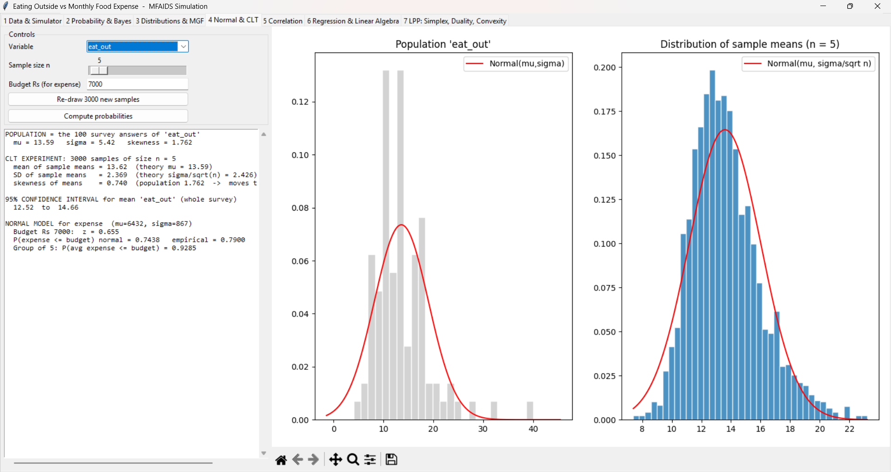
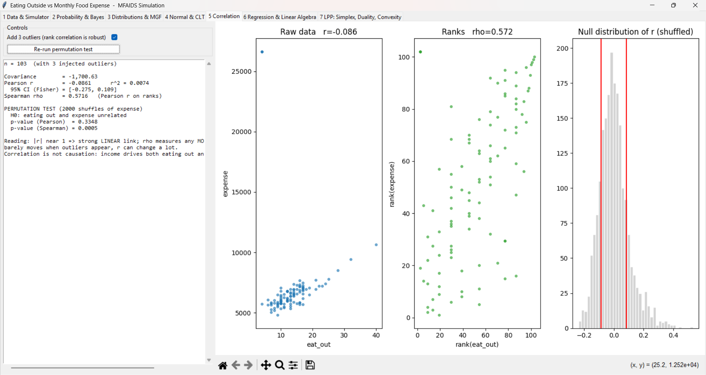
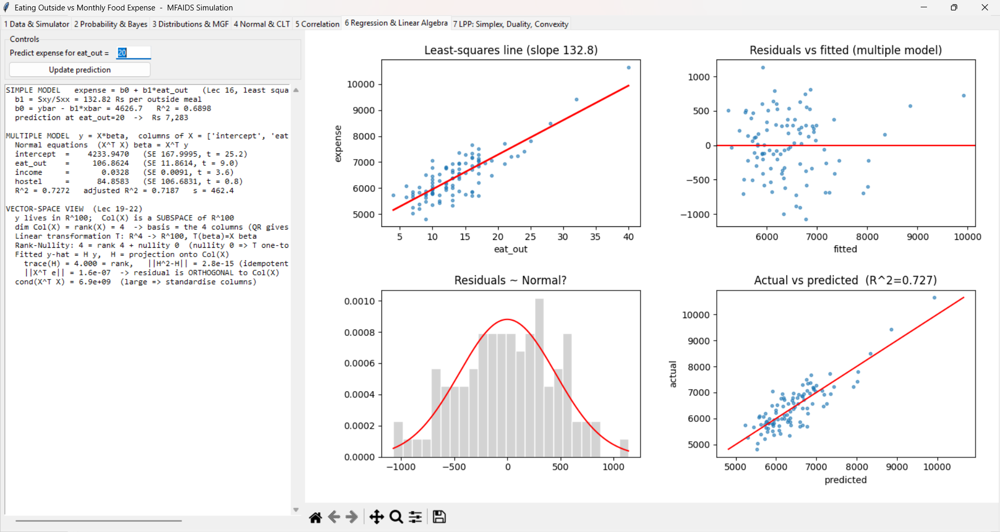
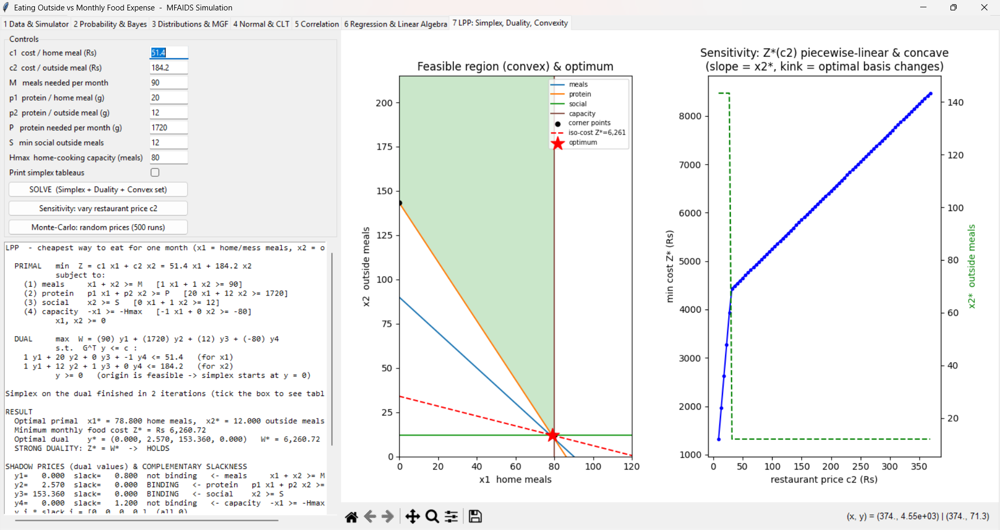
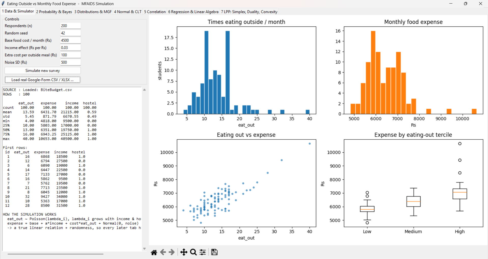
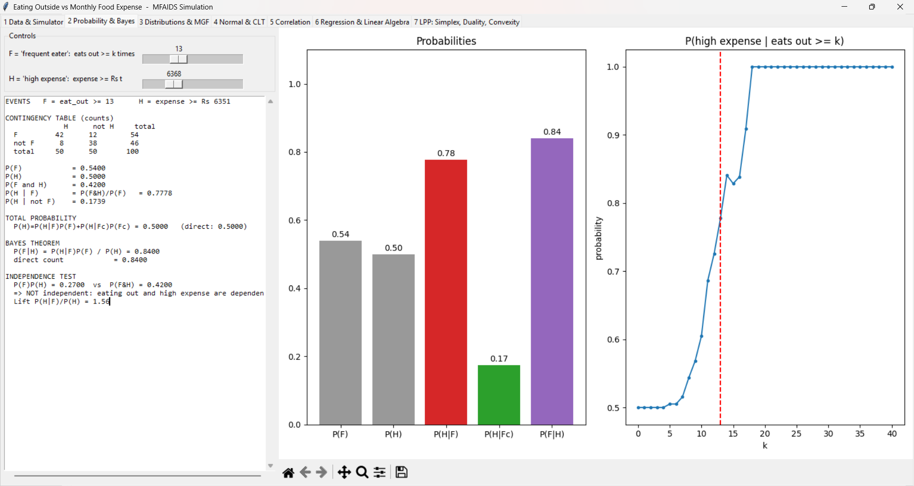
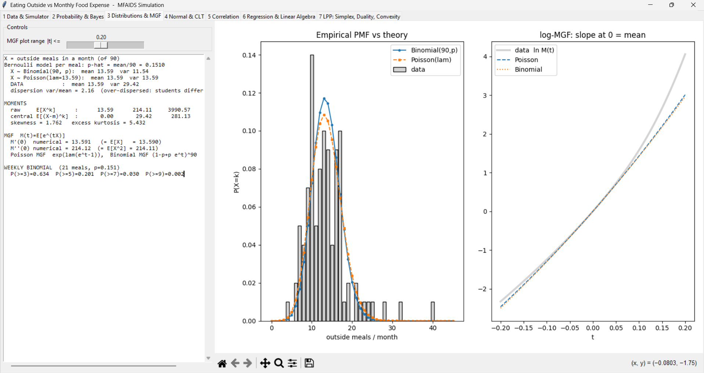

# 🍽️ MealMath — Eating Out vs Monthly Food Expense

> An interactive Python simulation that uses probability, statistics, linear algebra and linear programming to study how eating outside affects a student's monthly food expense.


Built for the course **Mathematical Foundations for Artificial Intelligence and Data Science** at the Jaypee Institute of Information Technology (JIIT), Noida. Every tab of the app maps to a block of lectures, and all of the core mathematics (distributions, Bayes, least squares, simplex, duality) is **implemented from scratch**, with no SciPy or scikit-learn.

---

## 📌 The question

> *Does eating outside more often raise a student's monthly food expense, by how much, and what is the cheapest way to eat while still meeting nutrition and social constraints?*

The project starts from a survey ("Eating Outside vs Monthly Food Expense") and answers the question in four steps:

1. **Describe** the data with probability and distributions.
2. **Quantify** the relationship with correlation and regression.
3. **Explain** the regression geometrically with vector spaces.
4. **Optimise** the monthly food plan with a linear programme.

---

## ✨ Features

| Tab | Syllabus topics | What it does |
|---|---|---|
| **1. Data & Simulator** | Poisson counts, noise | Generates a synthetic survey, or loads your own Google Form CSV/XLSX |
| **2. Probability & Bayes** | Probability, conditional probability, Bayes theorem | Contingency table, total probability, Bayes checked against direct counts, independence test, and P(high expense given eats out ≥ k) |
| **3. Distributions & MGF** | Random variables, Binomial, Poisson, moments, MGF | Fits Binomial(90, p) and Poisson to monthly outside meals, computes skewness and kurtosis, and verifies M′(0)=E[X] and M″(0)=E[X²] numerically |
| **4. Normal & CLT** | Normal distribution, CLT | Z-scores, budget probabilities, confidence intervals, and a 3000-sample bootstrap showing sample means becoming normal |
| **5. Correlation** | Pearson, Spearman rank correlation | Correlation with a permutation test. An outlier toggle shows rank correlation is robust |
| **6. Regression & Linear Algebra** | Least squares, vector space, subspace, basis, dimension, linear transformation | Normal equations, R², standard errors, column-space basis via QR, projection matrix, rank–nullity, residual orthogonality |
| **7. LPP** | Simplex, duality, convex sets | Minimum-cost meal plan solved by simplex on the dual, shadow prices, complementary slackness, convex feasible region, sensitivity and Monte-Carlo |

---

## 🖼️ Screenshots

**Central Limit Theorem — sample means become normal as n grows**


**Correlation — Pearson vs Spearman with a permutation test**


**Regression and linear algebra**


**Linear programming — convex feasible region, optimum and sensitivity**


<details>
<summary>More screenshots</summary>





</details>

---

## 🚀 Quick start

```bash
# 1. Clone
git clone https://github.com/Maharshi-Paul/MealMath.git
cd MealMath

# 2. Install dependencies
pip install -r requirements.txt

# 3. Run
python eating_out_vs_food_expense.py
```

**Requirements:** Python 3.9+, NumPy, Pandas, Matplotlib and Tkinter. Tkinter ships with the Windows and macOS Python installers. On Linux run `sudo apt install python3-tk`.

---

## 🧭 How to use

1. Open **Tab 1** and click **Simulate new survey**, or **Load real Google-Form CSV / XLSX**.
2. Every other tab updates automatically from the current data.
3. Move the sliders (thresholds, sample size) and buttons (resample, outliers, Solve) to experiment.

### Using your own survey data

Export your Google Form responses as CSV and load them in Tab 1. A dialog asks you to map columns:

| Field | Required | Meaning |
|---|---|---|
| Times eating outside per month | ✅ | Numeric count |
| Monthly food expense (Rs) | ✅ | Numeric amount |
| Monthly income / allowance | optional | Adds a regressor in Tab 6 |
| Hostel / PG (Yes/No) | optional | Adds a regressor in Tab 6 |

If a question was multiple-choice (for example "1–2 times a week"), convert it to an approximate monthly number first.

---

## 🧮 How it works

### Data model (simulator)

```
eat_out_i ~ Poisson(λ_i),   λ_i = exp(2.4 + 0.00004·(income_i − 22000) + 0.35·hostel_i)
expense_i = base + a·income_i + cost·eat_out_i + N(0, σ²)
```

This builds in a known linear relationship plus randomness, so each later tab has something real to recover.

### Regression as linear algebra

- Normal equations: **(XᵀX) β = Xᵀy**
- The columns of **X** span a subspace Col(X) ⊂ ℝⁿ whose dimension is rank(X).
- The fitted values are the projection **ŷ = Hy** with **H = X(XᵀX)⁻¹Xᵀ**. The app checks H² = H, trace(H) = rank, and that the residual satisfies Xᵀe = 0.
- **β ↦ Xβ** is a linear transformation ℝᵖ → ℝⁿ, and rank–nullity is verified.

### Linear programming

Regression prices feed the optimiser. The cost of a home meal is the intercept ÷ 90, and an outside meal costs that plus the slope.

```
minimise   c₁x₁ + c₂x₂             x₁ = home meals, x₂ = outside meals
subject to x₁ + x₂ ≥ M             (meals needed per month)
           p₁x₁ + p₂x₂ ≥ P         (protein)
           x₂ ≥ S                  (minimum social meals)
           x₁ ≤ H_max              (home-cooking capacity)
           x₁, x₂ ≥ 0
```

- The **dual** (`max hᵀy s.t. Gᵀy ≤ c, y ≥ 0`) starts at the origin, so a plain tableau simplex solves it.
- The primal optimum is read from the final tableau, and **strong duality** (Z\* = W\*) is verified.
- The dual values are **shadow prices**, and **complementary slackness** is checked.
- The feasible region is a **convex polyhedron**. The app enumerates its corner points and confirms the optimum is one of them.
- **Sensitivity:** Z\*(c₂) is concave and piecewise linear, with kinks where the optimal basis changes.

### Validation

The simplex solver was tested against SciPy's `linprog` and against brute-force corner enumeration on 300 random LPs, with no mismatches.

---

## 📁 Project structure

```
MealMath/
├── eating_out_vs_food_expense.py   # complete application (maths + GUI)
├── requirements.txt
├── README.md
└── screenshots/
```

The file has two parts: **Part A** is pure maths with no GUI (distributions, OLS, simplex, vertex enumeration), and **Part B** is the Tkinter interface.

---

## ⚠️ Limitations

- Default results come from **simulated** data. Load real survey responses to draw real conclusions.
- Correlation is not causation. Income drives both eating out and expense, so the simple-regression slope is inflated. The multiple regression in Tab 6 adjusts for this.
- The LP uses two decision variables so the feasible region can be drawn. The simplex code itself handles any number of constraints.
- The nutrition numbers (protein per meal and so on) are illustrative defaults and can be edited in Tab 7.

## 🔭 Future work

- More meal types in the LP (mess, delivery, canteen) with an n-variable simplex
- Logistic regression for "high spender" classification
- Export of charts and reports to PDF
- Real-survey analysis of JIIT students

---

## 📚 Course context

Mathematical Foundations for AI & Data Science covers probability, random variables, distributions, correlation, regression, vector spaces, linear transformations and optimisation. This project connects all of those into a single end-to-end example.

## 📄 License

Released under the MIT License. Add a `LICENSE` file when you create the repo (GitHub's "Add a license → MIT" template works).

## 👤 Author

**Maharshi**, B.Tech student at the Jaypee Institute of Information Technology (JIIT)
GitHub: [@Maharshi-Paul](https://github.com/Maharshi-Paul)

⭐ If you found this useful, consider starring the repo.
